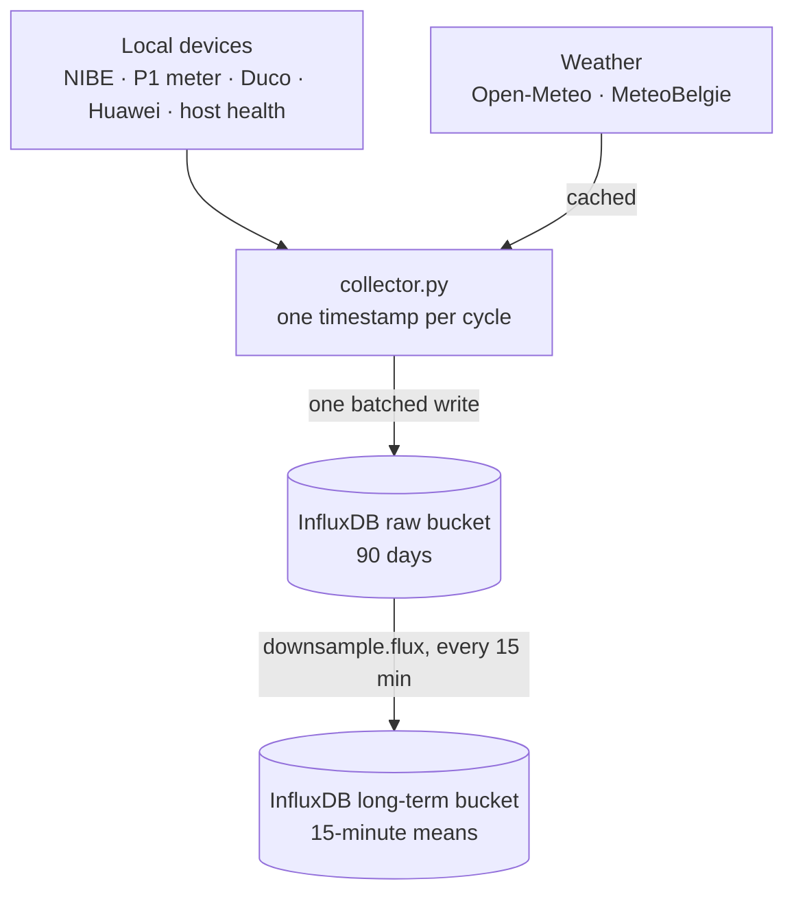

# Home energy data collector

A Python daemon that polls a heat pump, a solar inverter, a grid meter, a ventilation unit, the host it runs on and two weather sources, and writes everything to InfluxDB. The local devices share **one timestamp per cycle**, so they line up exactly for cross-device analysis. The weather sources keep their own observation time.

The write-up, including what the data turned up: [One clock, seven sources, and a fan fighting physics](https://gert-willem.netlify.app/blog/home-energy-collector/).

This repository is the collector extracted from a larger homelab setup. Dashboards and analysis jobs that read the same data live elsewhere.

## Sources

| Source | Protocol | Poll interval |
|---|---|---|
| NIBE heat pump | HTTPS REST, Basic auth via `~/.netrc` | 60 s |
| HomeWizard P1 meter | HTTP REST, no auth | 60 s |
| Duco ventilation | HTTP REST, no auth | 60 s |
| Huawei SUN2000 inverter | Modbus TCP via the SDongleA ([`huawei-solar`](https://pypi.org/project/huawei-solar/)) | 60 s |
| Proxmox host health | HTTP, [`health_endpoint.py`](health_endpoint.py) on the host | 60 s |
| Open-Meteo | Public HTTPS API, no key | 15 min, cached between fetches |
| MeteoBelgie station | Scraped web page | 1 h, cached between fetches |

No vendor cloud accounts or apps are involved: every device is polled directly on the local network.

## How it works



Each cycle, `collector.py`:

1. Takes one UTC timestamp, used for every device point written in that cycle.
2. Fetches every local source, each in its own `try/except`: one dead source never blocks the others, and errors are never written as data.
3. Reuses the cached weather responses unless their own, longer interval has elapsed. Weather points carry the source's observation time (Open-Meteo's `current.time`, the station page's "Overzicht van ..." header), not the cycle timestamp. Writing a cached reading again overwrites the same point instead of making it look fresh; align weather with device data at query time, for example with `fill(usePrevious: true)`.
4. Flattens every response into InfluxDB points with one generic function, `to_points()`, that knows no field names. Numeric-keyed dicts and lists become one point per entity, nested dicts become path-joined field names, strings become tags and numbers become float fields. A few explicit, documented exceptions handle protocol quirks (NIBE's sentinel value and divisor, Huawei's datetime and flag types, smartctl's per-run timestamp string). The two weather sources are built by hand with chosen field names.
5. Writes all points in one synchronous call, then sleeps until the next cycle. Cycles start `COLLECTOR_INTERVAL` apart on the monotonic clock, so fetch time doesn't stretch the interval.

[`downsample.flux`](downsample.flux) is the InfluxDB task that rolls the raw data up into 15-minute means for the long term. It works on an allowlist of numeric fields, because Flux's `mean()` fails on strings and booleans.

## Running it

Requires Python 3.11+ and [uv](https://docs.astral.sh/uv/).

```bash
uv sync
cp .env.example .env    # fill in device addresses, location and InfluxDB settings
uv run collector.py
```

NIBE credentials go in `~/.netrc` (`machine <NIBE_HOST> login ... password ...`), not in `.env`. The InfluxDB token only needs write access.

In production the collector runs as a systemd service ([`deploy/collector.service`](deploy/collector.service)) with `Restart=always`. `health_endpoint.py` runs on the Proxmox host itself, from a clone of this repository ([`deploy/health-endpoint.service`](deploy/health-endpoint.service)); updating it is `git pull` and a service restart.

## Tests

```bash
uv run pytest
```

The tests cover the flatten rules of `to_points()`, the source-specific steps around it, and `build_points()` with every source at once, including failed sources being skipped. They use synthetic device responses; no hardware or InfluxDB is needed.

## License

MIT
